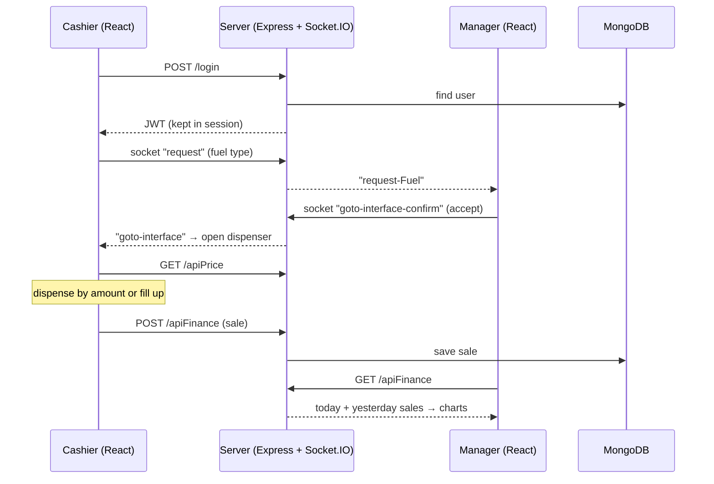

# Oil Manage System

A web app that simulates a gas station's point of sale. A **Cashier** asks to open a pump, a **Manager** approves it in real time, the cashier dispenses fuel by amount or "fill up", and every sale is recorded for the manager's sales dashboard.

**Stack:** React 19 · Vite · Tailwind CSS 4 · Recharts · Node.js · Express · Socket.IO · MongoDB (Mongoose) · JWT

---

## Features

| Role | What they can do |
|---|---|
| **Cashier** | Pick a fuel type and send a pump request to the manager · dispense by baht amount or fill up (live litres/price counter) · choose a payment method and record the sale |
| **Manager** | Approve or reject pump requests in real time · sales dashboard (today / yesterday charts and full history) · set fuel prices, with today's PTT reference prices scraped from the web · view fuel stock levels |

- **Real-time messaging** between cashier and manager screens with Socket.IO
- **Login with role-based pages** — JWT stored in a server-side session (`express-session`), separate access for Manager and Cashier
- **Reference prices** — scrapes current PTT prices (`axios` + `cheerio`) so the manager can compare before updating prices

## How it works



## Project structure

```
.
├── back-end/
│   ├── server.js            Express + Socket.IO server, MongoDB connection
│   ├── middleware.js        CORS and session config
│   └── src/
│       ├── models/          Mongoose schemas: User, Finance (sales), Price
│       └── routers/         login, role pages, sales, prices, price scraper
└── front-end/
    └── src/
        ├── pages/           Login, Cashier, Manager
        ├── components/      dispenser, dashboard, price manager, stock, sidebar
        └── socket.js        Socket.IO client
```

## API

| Method | Path | Purpose |
|---|---|---|
| POST | `/login` | Check username/password, return a JWT and the user's role |
| GET | `/main/Manager` · `/main/Cashier` | Return the signed-in user's profile for that role |
| POST | `/apiFinance` | Record a sale |
| GET | `/apiFinance` | Sales for today and yesterday |
| GET | `/apiFinanceAll` | All sales |
| GET | `/apiPrice` | Current fuel prices |
| PUT | `/apiUpdatePrice` | Update one fuel price |
| GET | `/apiPriceFuel` | Today's PTT reference prices (scraped) |

## Getting started

Requires Node.js 18+ and MongoDB running on `localhost:27017`.

```bash
# 1. back-end (http://localhost:3000)
cd back-end
cp .env.example .env        # then set SESSION_SECRET and JWT_SECRET to random values
npm install
node server.js

# 2. front-end (http://localhost:5173)
cd ../front-end
npm install
npm run dev
```

Seed a manager, a cashier and starting prices (the app has no sign-up page):

```bash
mongosh pttDB --eval '
db.users.insertMany([
  { username: "manager", password: "manager123", name: "Demo Manager", position: "Manager" },
  { username: "cashier", password: "cashier123", name: "Demo Cashier", position: "Cashier" }
]);
db.prices.insertOne({ gasohol95: 35.05, gasohol91: 34.68, gasoholE85: 32.39, gasoholE20: 30.95 });
'
```

Open http://localhost:5173 and sign in as the manager in one window and the cashier in another to try the real-time flow.

## Roadmap

- Hash passwords (Argon2/bcrypt) and require a valid token on every API route
- Persist fuel stock in the database and reduce it on each sale
- Move API and socket URLs into environment variables
- Add tests and a Docker Compose setup
